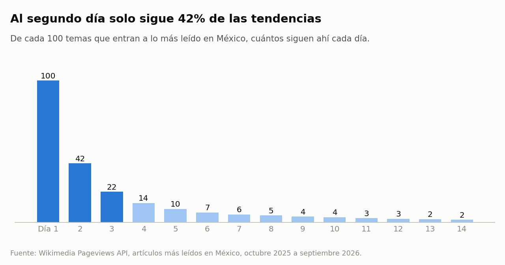
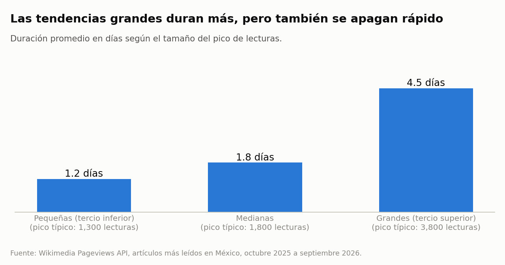

# Vida de una tendencia

**¿Cuánto dura un tema en la atención de México?**
Un año de los artículos de Wikipedia más leídos en el país, día por día.

> **English summary.** Trend lifecycle analysis using Wikimedia's "top per country" data for Mexico (359 days, October 2025 to September 2026). An article entering the daily most-read list starts a trend; consecutive days on the list measure its lifetime. Of 8,115 trends, 58% last a single day, only 42% are still there on day two and 6% last a week. For marketing teams this quantifies the reaction window for real-time content.

## Hallazgos

**1. Más de la mitad de las tendencias dura un solo día.** De 8,115 temas que entraron a la lista de lo más leído en México, 58% salió al día siguiente y 86% duró tres días o menos.



**2. La ventana para reaccionar es de un día.** Al segundo día solo sigue 42% de las tendencias; al tercero, 22%; a la semana, 6%.

**3. Las tendencias llegan de golpe.** Entre las que duran dos días o más, la mitad alcanza su máximo el primer día y 85% en los dos primeros. No hay tiempo de "ver si crece".

**4. Las grandes duran más, pero tampoco mucho.** El tercio de tendencias con picos más altos dura 4.5 días en promedio; el tercio más pequeño, 1.2.



**5. Pocas cosas son permanentes.** Solo 9 artículos estuvieron en la lista más de la mitad del año, y uno solo apareció los 359 días: ChatGPT. Las tendencias más largas, de más de dos meses, fueron de entretenimiento y futbol, como Stranger Things (79 días) y la Copa Mundial de Futbol (67 días).

## Para qué sirve

Un equipo de contenidos o de redes sociales que quiere aprovechar un tema del momento tiene que publicar el mismo día: si la aprobación tarda 48 horas, cuatro de cada cinco tendencias ya se fueron.

## Método

- **Datos.** Para cada día, Wikimedia publica los artículos más leídos desde México. Se usan solo artículos de Wikipedia en español, sin portadas, buscadores ni páginas especiales: 23,158 apariciones de 4,221 artículos, unas 56 por día.
- **Tendencia.** Una racha de días consecutivos en la lista. Si un artículo sale y vuelve a entrar, cuenta como una tendencia nueva.
- **No son tendencias** los artículos presentes más de la mitad del año.
- **Rachas incompletas.** Se descartan las que tocan el primer o el último día del periodo, porque pudieron empezar antes o seguir después.
- **Días sin datos.** Wikimedia no publicó 6 de los 365 días; no cortan una racha.
- **Tamaño.** Las tendencias se dividen en tercios según su pico de lecturas.

## Limitaciones

- **La lista tiene un piso.** Por privacidad, Wikimedia solo incluye artículos por encima de cierto número de lecturas (aquí, 1,100 al día). "Salir de la lista" es caer bajo ese piso, no dejar de leerse. Las tendencias pequeñas rozan el piso y por eso parecen más cortas.
- **Lecturas redondeadas.** Las cifras vienen redondeadas hacia arriba a la centena.
- **Wikipedia no es toda la atención.** Mide qué se busca para informarse, no lo que circula en redes o televisión.
- **Un artículo no es un tema.** Una noticia puede repartirse entre varios artículos; aquí cada uno cuenta por separado.
- **Un solo año**, que incluyó un Mundial de futbol con sede en México.

## Por qué el repositorio no incluye la lista de artículos

La lista diaria contiene nombres de personas que fueron noticia y contenido para adultos. Este análisis trata de cuánto duran las tendencias, no de quién fue tendencia, así que solo se publican los resultados agregados. Los datos son públicos y cualquiera puede descargarlos con el comando de abajo.

## Reproducirlo

```bash
pip install -r requirements.txt
python -m tendencias.data
python -m tendencias
python -m pytest
```

La descarga hace una consulta por día con pausas, y tarda unos 30 minutos.

## Fuente y licencia

Datos: [Wikimedia Pageviews API](https://wikimedia.org/api/rest_v1/), dominio público (CC0). Código bajo licencia MIT.
